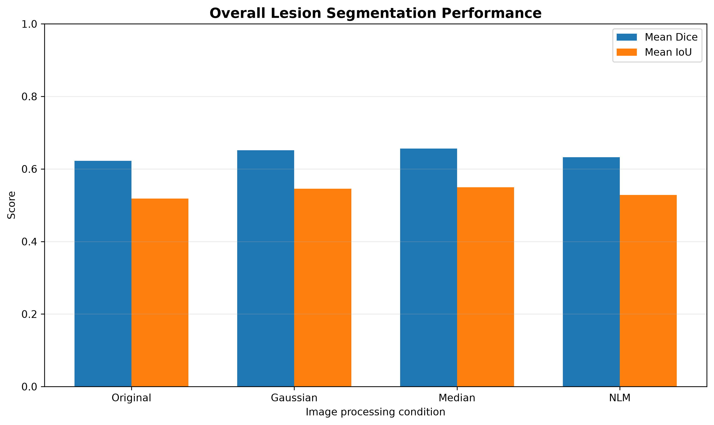
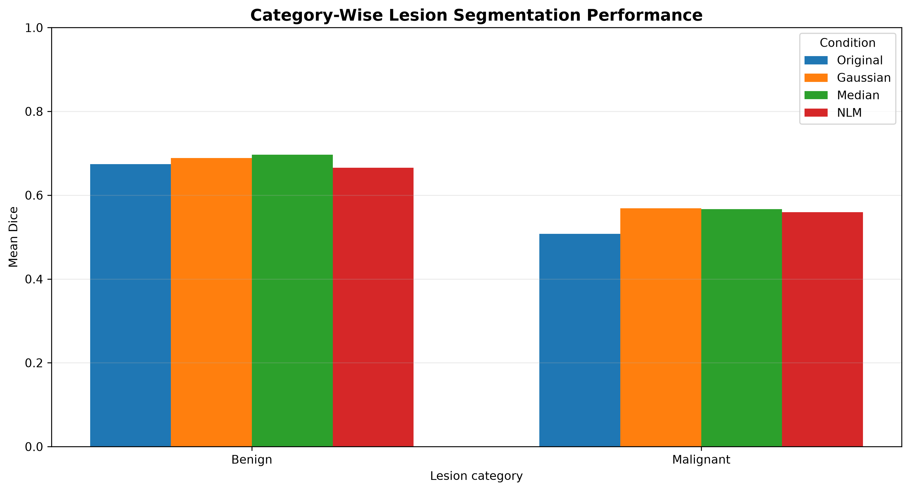
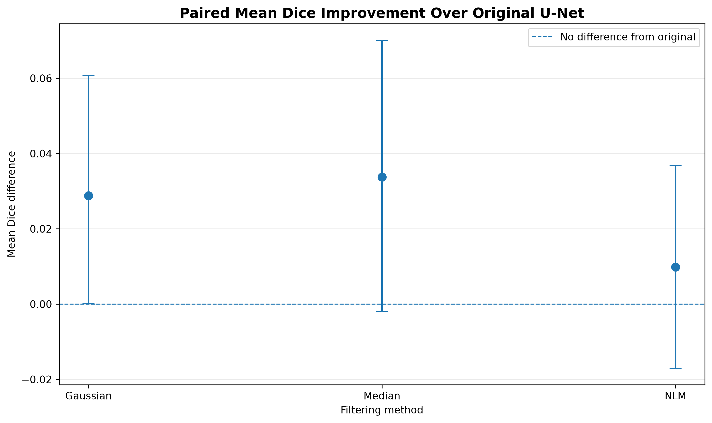

# Breast Ultrasound Lesion Segmentation: Effect of Despeckling on U-Net Performance

Investigating whether ultrasound despeckling techniques improve breast lesion segmentation using U-Net.

## Overview

Ultrasound images frequently contain speckle noise, which can make lesion boundaries difficult to distinguish. Image denoising techniques are commonly used to reduce this noise, but excessive smoothing may also remove diagnostically relevant boundary information.

This project investigates the effect of three despeckling techniques on deep-learning-based breast lesion segmentation:

- Gaussian filtering
- Median filtering
- Non-Local Means (NLM) filtering

A separate U-Net model was trained for each filtering condition and compared against a model trained on original ultrasound images.

The objective is to determine whether despeckling improves segmentation accuracy and how different filtering techniques affect lesion detection, boundary overlap and false-positive predictions.

## Research Questions

1. Does despeckling improve U-Net-based breast lesion segmentation?
2. Which filtering technique provides the best segmentation performance?
3. Do filtering methods affect benign and malignant lesion segmentation differently?
4. Does despeckling reduce false-positive predictions on normal ultrasound images?
5. Are the observed improvements statistically supported?

## Dataset

**Dataset:** Breast Ultrasound Images Dataset (BUSI)

The dataset was organized into three categories:

- Benign
- Malignant
- Normal

Images and their corresponding segmentation masks were preprocessed and resized to 256 × 256 pixels.

A leakage-aware data split was used:

| Split | Number of images |
|---|---:|
| Training | 543 |
| Validation | 117 |
| Testing | 118 |
| **Total** | **778** |

The independent test set contained:

| Category | Images |
|---|---:|
| Benign | 67 |
| Malignant | 30 |
| Normal | 21 |
| **Total** | **118** |

The original dataset is not included in this repository. It must be obtained separately and placed in the expected project directory structure.

## Methodology

### 1. Image preprocessing

- Duplicate image auditing.
- Grayscale conversion.
- Image resizing to 256 × 256.
- Binary segmentation mask preparation.
- Leakage-aware training, validation and test splitting.

### 2. Despeckling

Three filtering techniques were applied independently:

| Condition | Description |
|---|---|
| Original | No additional filtering |
| Gaussian | Gaussian smoothing |
| Median | Median filtering |
| Non-Local Means | Patch-similarity-based denoising |

### 3. U-Net architecture

A U-Net architecture was implemented for binary lesion segmentation.

Model characteristics:

- Single-channel grayscale input.
- Encoder-decoder architecture.
- Skip connections.
- Convolutional blocks with batch normalization and ReLU activation.
- Single-channel output for lesion probability prediction.
- Approximately 1.93 million trainable parameters.

### 4. Model training

Four independent models were trained using identical experimental configurations.

| Parameter | Configuration |
|---|---|
| Architecture | U-Net |
| Input size | 256 × 256 |
| Batch size | 4 |
| Learning rate | 0.0001 |
| Training epochs | 30 |
| Random seed | 42 |
| Optimizer | Same across all four conditions |
| Model selection | Best validation Dice |

The best validation checkpoints were:

| Condition | Best epoch | Validation Dice |
|---|---:|---:|
| Original | 25 | 0.7105 |
| Gaussian | 27 | 0.6719 |
| Median | 25 | 0.7020 |
| Non-Local Means | 23 | 0.6807 |

The final comparison uses the best checkpoint from each training run.

### 5. Evaluation metrics

Lesion segmentation performance was evaluated using:

- Dice coefficient
- Intersection over Union (IoU)
- Pixel-level precision
- Pixel-level sensitivity

Additional analyses included:

- Benign and malignant lesion performance.
- False-positive image count on normal images.
- Mean predicted lesion area on normal images.
- Paired statistical comparisons.

A fixed probability threshold of 0.5 was used for all predictions.

Dice and IoU averages were calculated over the 97 lesion images. Normal images with empty ground-truth masks were evaluated separately.

Pixel precision and sensitivity in the overall comparison represent pooled pixel-level metrics across the 97 lesion images.

## Experimental Results

### 1. Overall segmentation performance

| Condition | Mean Dice | Mean IoU | Pixel Precision | Pixel Sensitivity |
|---|---:|---:|---:|---:|
| Original | 0.6227 | 0.5185 | **0.8548** | 0.5447 |
| Gaussian | 0.6515 | 0.5456 | 0.8257 | 0.5743 |
| Median | **0.6565** | **0.5492** | 0.8306 | **0.5750** |
| NLM | 0.6326 | 0.5284 | 0.8359 | 0.5492 |

Median filtering achieved the highest mean Dice and IoU.

Compared with the original model, mean Dice improved by:

- Gaussian: +0.0288
- Median: +0.0337
- NLM: +0.0099

### 2. Category-wise performance

| Condition | Benign Dice | Malignant Dice |
|---|---:|---:|
| Original | 0.6741 | 0.5081 |
| Gaussian | 0.6885 | **0.5688** |
| Median | **0.6967** | 0.5665 |
| NLM | 0.6654 | 0.5593 |

Median filtering performed best on benign lesions, whereas Gaussian filtering achieved the highest Dice on malignant lesions.

### 3. Normal-image false positives

| Condition | False-positive images | False-positive rate |
|---|---:|---:|
| Original | 12/21 | 57.14% |
| Gaussian | **10/21** | **47.62%** |
| Median | 15/21 | 71.43% |
| NLM | 13/21 | 61.90% |

Gaussian filtering produced the fewest normal-image false-positive predictions.

NLM produced the lowest mean predicted lesion area on normal images, at approximately 163.62 pixels per image.

### 4. Statistical analysis

Paired comparisons were performed using the same 97 lesion images for all four conditions.

The analysis included:

- 10,000 paired bootstrap resamples.
- 95% bootstrap confidence intervals for mean Dice differences.
- Wilcoxon signed-rank tests.
- Holm correction for multiple comparisons.

| Filter | Mean Dice difference | 95% CI | Holm-adjusted p-value |
|---|---:|---:|---:|
| Gaussian | +0.0288 | [0.0001, 0.0608] | 0.5650 |
| Median | +0.0337 | [-0.0020, 0.0701] | 0.1610 |
| NLM | +0.0099 | [-0.0171, 0.0369] | 0.7989 |

None of the three filtering methods demonstrated a statistically significant Dice improvement after Holm correction at the 0.05 significance level.

Although median and Gaussian filtering showed promising improvements in average Dice, the results do not establish that despeckling reliably improves segmentation.

## Visual Results

### Overall Dice and IoU



### Category-wise segmentation performance



### Paired statistical comparison



### Representative segmentation examples

The following examples illustrate how filtering can improve or worsen segmentation on individual ultrasound images.

**Largest average improvement**

.png)

**Typical case**

.png)

**Largest average decline**

.png)

Additional figures, including normal-image false-positive visualizations, are available in `results/filter_comparison/visualizations/`.

## Main Conclusion

Median filtering achieved the highest average lesion Dice and IoU, while Gaussian filtering performed best on malignant lesions and produced the fewest false-positive normal images.

However, none of the filtering methods showed a statistically significant Dice improvement after multiple-comparison correction.

The experiment suggests that the effectiveness of despeckling depends on the evaluation metric and lesion category. Improvements in lesion overlap do not necessarily translate into fewer false-positive predictions on normal images.

Therefore, no single filtering method can be considered universally superior based on the current experimental results.

## Repository Structure

```text
bus-speckle-seg/
│
├── models/
│   ├── baseline_unet_best.pth
│   ├── original_seed42_best.pth
│   ├── gaussian_seed42_best.pth
│   ├── median_seed42_best.pth
│   └── non_local_means_seed42_best.pth
│
├── notebooks/
│   ├── 01_eda.ipynb
│   ├── 03_unet_training.ipynb
│   ├── 04_model_evaluation.ipynb
│   ├── 05_prediction_visualization.ipynb
│   ├── 06_despeckling.ipynb
│   ├── 07_despeckling_training.ipynb
│   └── 08_filter_comparison_evaluation.ipynb
│
├── results/
│   ├── training/
│   ├── evaluation/
│   ├── despeckling/
│   ├── visualizations/
│   └── filter_comparison/
│
├── data/                 # Not included in GitHub
├── .gitignore
└── README.md
```

## Installation and Execution

### 1. Clone the repository

```bash
git clone https://github.com/priyanshur25/bus-speckle-seg.git

cd bus-speckle-seg
```

### 2. Create a Python environment

```bash
python -m venv .venv

source .venv/bin/activate
```

### 3. Install dependencies

Install the required Python packages used by the notebooks, including:

```bash
pip install numpy pandas matplotlib pillow scipy opencv-python jupyter
```

Install the appropriate PyTorch build for your hardware:

https://pytorch.org/get-started/locally/

### 4. Prepare the dataset

Obtain and preprocess the BUSI dataset separately.

Arrange the processed dataset under:

```text
data/
└── processed/
    ├── preprocessed/
    │   ├── train/
    │   │   ├── images/
    │   │   └── masks/
    │   ├── validation/
    │   │   ├── images/
    │   │   └── masks/
    │   └── test/
    │       ├── images/
    │       └── masks/
    │
    └── despeckled/
        ├── original/
        ├── gaussian/
        ├── median/
        └── non_local_means/
```

The notebook configurations and manifest files should be checked against the local dataset paths before running the experiments.

### 5. Launch Jupyter

```bash
jupyter notebook
```

Open the notebooks in the `notebooks/` directory.

For the main comparative experiment, start with:

`08_filter_comparison_evaluation.ipynb`

The trained model checkpoints and saved evaluation results are included in the repository.

## Limitations

1. The experiments were conducted on a single dataset.
2. Only one random seed (42) was used for the four comparison models.
3. The independent test set contained 97 lesion images and 21 normal images.
4. Only three despeckling techniques were investigated.
5. Filter parameters were not exhaustively optimized.
6. External dataset validation was not performed.
7. The evaluation focuses on segmentation performance and does not establish clinical diagnostic effectiveness.

## Future Work

- Evaluate multiple independent random seeds.
- Investigate adaptive and edge-preserving despeckling methods.
- Study the effect of filtering strength on lesion boundaries.
- Validate on external breast ultrasound datasets.
- Explore boundary-specific segmentation metrics.
- Investigate adaptive filter selection based on ultrasound image characteristics.

## Technologies Used

- Python
- PyTorch
- U-Net
- NumPy
- Pandas
- OpenCV
- Matplotlib
- SciPy
- Jupyter Notebook

---

**Research focus:** Understanding the trade-off between ultrasound speckle reduction and preservation of diagnostically relevant lesion boundaries.

**Repository:** https://github.com/priyanshur25/bus-speckle-seg
